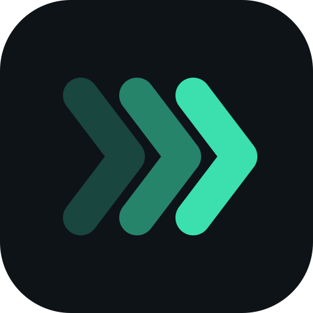
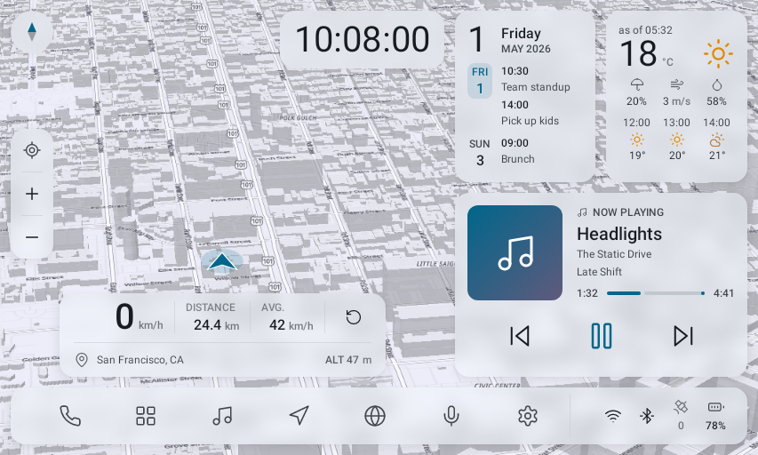
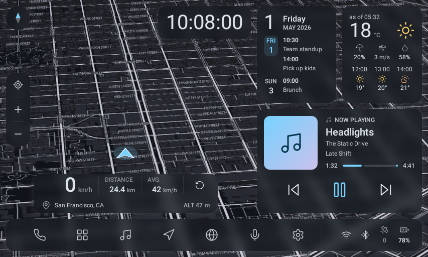

<div align="center">



# Femto Car Launcher

**A glanceable Android home launcher for in-car displays.**

[](https://github.com/seijikohara/femto-car-launcher/actions/workflows/ci.yml) [](https://github.com/seijikohara/femto-car-launcher/releases/latest) [](https://github.com/seijikohara/femto-car-launcher/releases/tag/nightly) [-3DDC84?logo=android&logoColor=white)](https://developer.android.com/about/versions/13)

</div>

Femto Car Launcher replaces the Android home screen with a single fixed dashboard designed for automotive viewing distances and touch accuracy. The dashboard combines a live map, driving data, weather, calendar, and media control on one screen, so you read the essentials at a glance instead of switching between apps.

Femto Car Launcher targets three hardware classes: aftermarket CarPlay / Android Auto AI boxes that inject Android into a factory display, Android head units (aftermarket units installed in the dashboard), and car-mounted phones. On a phone the launcher also runs as a regular app; making it the default home screen stays optional. The minimum supported platform is Android 13, which is Application Programming Interface (API) level 33. No single market is privileged: language, units, and locale-specific behavior adapt per device.

<div align="center">





<sub>The dashboard on a head-unit display, light and dark. The map style follows the theme. These images are the project's own screenshot-test references. Continuous integration compares them with the current code on every pull request, so a mismatch blocks the merge. The map behind the interface is a still capture of the OpenStreetMap provider: the live map renders in a WebView, which the screenshot harness cannot run (see <a href="app/src/test/resources/README.md">app/src/test/resources</a>).</sub>

</div>

## Features

Each area has a page on the project site with the details, the settings behind it, and what happens when a permission or a data source is missing.

- **[Live map](https://seijikohara.github.io/femto-car-launcher/features/live-map/).** The dashboard background is a map that fills the display, follows the vehicle, and keeps the direction of travel pointing up. OpenStreetMap data works without an account or a key; Google Maps is available with your own API key.
- **[Driving data and trips](https://seijikohara.github.io/femto-car-launcher/features/driving-data/).** Current speed, trip distance, average speed, altitude, and the address of the current position in high-contrast numerals. The launcher records trips on the device, exports the track history as a GPS Exchange Format (GPX) file, and replays a trip as a three-dimensional flythrough.
- **[Glanceable panels](https://seijikohara.github.io/femto-car-launcher/features/panels/).** Weather, calendar, now-playing controls for any media app, an optional video window, a clock, and connectivity and battery status, as floating cards over the map. The weather, calendar, and music cards open full-screen panels.
- **[Apps and voice](https://seijikohara.github.io/femto-car-launcher/features/apps-and-voice/).** A dock on any screen edge, a full-screen app panel with search and pinned apps, a destination panel that hands a place to your navigation app, and a microphone button for the device's assistant.
- **[Automotive defaults and adjustments](https://seijikohara.github.io/femto-car-launcher/features/made-for-the-car/).** Text and touch targets sized for the car by default, a layout anchored on the driver's side, landscape and portrait orientations, and settings for display size, colors, fonts, motion, and units. The launcher has no driving lockout; a few features pause themselves while the vehicle moves.
- **[Privacy and data](https://seijikohara.github.io/femto-car-launcher/features/privacy/).** No account, no advertising, and no analytics of its own. Calendar, media, and trip data stay on the device, and location leaves it only inside requests to the services you use.

Nightly builds also carry features that are still being checked on in-car hardware; at present, a route to a destination drawn on the launcher's own map and computed on the device, and saving map regions on the device.

## Documentation

The [project site](https://seijikohara.github.io/femto-car-launcher/) is where the details live. The site is published with each stable release, so the description of a feature that is new in nightly builds can be missing there until the next one.

- **[Install guide](https://seijikohara.github.io/femto-car-launcher/install/)**: downloading a build, making the launcher the home screen, the update flow, the optional Google Maps provider, and building from source.
- **[Screenshot catalog](https://seijikohara.github.io/femto-car-launcher/catalog/)**: the dashboard across display geometries, display sizes, themes, driver sides, and dock positions.
- **[Privacy Policy](PRIVACY.md)** and **[Terms of Service](TERMS.md)**: what the app does with data, and the terms of use. Both are also reachable in the app.

## Installation

Femto Car Launcher publishes two channels as release-signed Android packages (APKs), both built from this repository by continuous integration:

- **Stable**: a dated release that changes only when the maintainer promotes a build. Download `femto-car-launcher-v<version>.apk` from the [latest release](https://github.com/seijikohara/femto-car-launcher/releases/latest).
- **Nightly**: a rolling build that changes often and may break. Download `femto-car-launcher-nightly.apk` from the [`nightly`](https://github.com/seijikohara/femto-car-launcher/releases/tag/nightly) prerelease.

The two channels install side by side. Install either APK by sideloading on the device, or from a computer with Android Debug Bridge: `adb install -r <file>.apk`. Play Store publication is not planned at present; sideloading is the supported installation path. Android 13 or later is required. The app checks for updates itself; the [install guide](https://seijikohara.github.io/femto-car-launcher/install/) describes the rest.

## Building from source

The build needs a Java Development Kit (JDK) 25, the Android software development kit (SDK), and an Android 13+ device or emulator. The Gradle build provisions Node.js and pnpm on demand for the bundled map page.

```bash
./gradlew assembleStableDebug   # debug APK at app/build/outputs/apk/stable/debug/
./gradlew test lint             # unit tests and Android Lint
```

[`CONTRIBUTING.md`](CONTRIBUTING.md) explains how to report bugs, propose features, and submit changes; the coding rules and verification commands live in [`AGENTS.md`](AGENTS.md) and `.claude/rules/`.

## License

Femto Car Launcher is licensed under the Apache License, Version 2.0 ([`LICENSE`](LICENSE)). Bundled third-party components keep their own licenses, listed in the app under **Settings → System → Open source licenses**.
